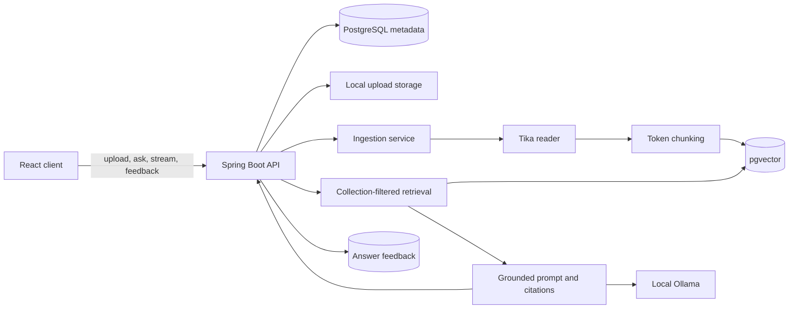
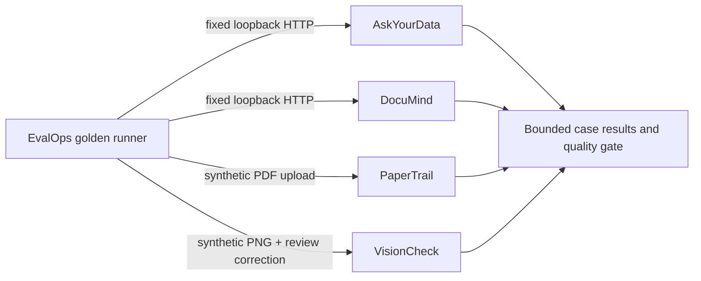

# Architecture

## Portfolio layout

The repository is a set of related but independently runnable projects. Shared documentation describes recurring patterns; application code stays in each project's directory to avoid hidden coupling and conflicting framework versions.

## DocuMind first milestone

Document metadata and original files are stored separately from vector chunks. Each indexed chunk carries its collection, document and filename metadata. The query path applies a collection filter before generation. Retrieved document text is context data and must never be followed as an instruction.

## Local data flow

1. Validate the extension, content type and 25 MB size limit.
2. Hash the upload and reject an already indexed copy in the same collection.
3. Save the source file, create a processing record and hand off ingestion.
4. Extract text, split it into bounded chunks and attach source metadata.
5. Store chunks in pgvector and update the metadata record's status.
6. Retrieve only matching collection chunks, ask the local chat model, and return answer plus source snippets.

## Cross-application evaluation

EvalOps is the local integration point for deterministic quality checks. Each adapter uses a fixed, validated loopback origin and a versioned fixture; it never accepts an arbitrary target URL from a request. The existing adapters cover fixed AskYourData reports, DocuMind evidence/citation checks, PaperTrail invoice extraction, and VisionCheck's image-to-human-review lifecycle.

Golden reports keep case IDs and aggregate/check results rather than full model answers, source text, or image bytes. The current datasets are small and synthetic; passing a gate shows only that a known local workflow matched its fixture, not that the model or heuristic is broadly accurate.

## Trust boundaries

- Local uploads are untrusted input; allow-list types and cap sizes.
- Prompt context is untrusted input; the model is explicitly told not to follow it as instructions.
- The initial application is a single-user local learning tool. Collection IDs are data partitioning, not authentication or tenant security.
- No GitHub write action, cloud model call or public deployment is enabled by default.

