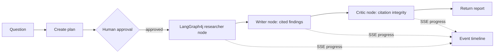

# Research Crew

## Purpose and learning goals

Research Crew demonstrates a reviewable research workflow for questions that need sourced evidence. It teaches approval gates, retrieval, citation checks, and the distinction between a workflow made of roles and a genuinely autonomous multi-agent graph.

**Current implementation:** a LangGraph4j `StateGraph` runs deterministic researcher, writer, and critic nodes over four local learning cards after a human approves the plan. A Server-Sent Events endpoint reports stage progress while the graph runs and replays events for completed in-memory runs. Pending plans persist in a local H2 file and return after restart. Optional PostgreSQL checkpoints restore completed reports after an app restart. Check the graph stages and citations before using a report. The app does not call an LLM or browse the web.

## How it works



## Run and try it

Requires Java 21 and Maven. From this directory run `mvn spring-boot:run`; the API binds to `127.0.0.1:8084`.

For durable approved-run checkpoints, start the local PostgreSQL service with `docker compose up -d`, then configure and start the app:

```powershell
$env:RESEARCH_CREW_CHECKPOINTS_ENABLED = 'true'
$env:RESEARCH_CREW_DB_PORT = '5433'
$env:RESEARCH_CREW_DB_PASSWORD = 'research-crew-local-only'
mvn spring-boot:run
```

The compose file binds PostgreSQL to loopback and uses a persistent local volume. Its fallback password is for this local learning stack only; override it with a private value when needed. Pending drafts are stored by default in `./data/research-crew-plans.mv.db`; set `RESEARCH_CREW_PLAN_DB_URL` to use another H2 or compatible JDBC URL. Keep the run ID returned by `/plans`: an unapproved draft can be edited or approved after restarting the app. After approval, LangGraph4j stores workflow checkpoints in PostgreSQL. After restarting the app, `POST /api/research/{id}/approve` with `{"approved":true}` can reconstruct the completed report from that run ID.

```powershell
$plan = Invoke-RestMethod -Method Post -Uri http://127.0.0.1:8084/api/research/plans `
  -ContentType 'application/json' -Body '{"topic":"RAG retrieval grounding"}'
$plan
# Open the progress stream in another terminal before approving:
curl.exe -N "http://127.0.0.1:8084/api/research/$($plan.id)/events"
# Then approve in this or another terminal:
Invoke-RestMethod -Method Put -Uri "http://127.0.0.1:8084/api/research/$($plan.id)/plan" `
  -ContentType 'application/json' -Body '{"topic":"prompt injection untrusted"}'
Invoke-RestMethod -Method Post -Uri "http://127.0.0.1:8084/api/research/$($plan.id)/approve" `
  -ContentType 'application/json' -Body '{"approved":true}'
Invoke-WebRequest "http://127.0.0.1:8084/api/research/$($plan.id)/report.md" -OutFile research-report.md
```

Expected: the plan starts as `PENDING_APPROVAL`; the approved report contains only findings linked to local source IDs such as `[S1]`, and reports whether the critic check passed. A non-matching topic yields no invented findings. A request with `approved:false` returns HTTP 409.

## Tests and exercises

Run `mvn test`. Tests cover Spring API wiring, refusal without approval, bounded plan edits, graph stage order, citation checks, empty results when no local evidence matches, Markdown export, replay of the completed SSE event timeline, and (when Docker is available) PostgreSQL checkpoint restoration.

1. Edit the topic to `prompt injection untrusted` before approving and inspect which local source is selected. Plans allow at most three edits.
2. Try a topic that matches no card and confirm the report has no findings.
3. Approve the same plan twice and compare the returned report. Then add a persistent checkpointer and prove the run can be resumed after restart.

## Limitations and next work

LangGraph4j 1.9.3 runs the downstream stateful graph. PostgreSQL checkpoint storage is optional and must be enabled with the documented environment variables. Planner, researcher and critic nodes are deterministic local stages rather than LLM agents; live source tools and durable SSE event history remain open. The server caps active plans at 100. SSE progress events remain in memory and are not restored after a restart. The upstream [LangGraph4j project](https://github.com/langgraph4j/langgraph4j) documents its Java state graph and checkpoint support.

**Screenshot placeholder:** add a capture of plan approval and the cited report after a UI is implemented.

References: [LangGraph4j](https://github.com/langgraph4j/langgraph4j), [LangChain4j](https://docs.langchain4j.dev/).
