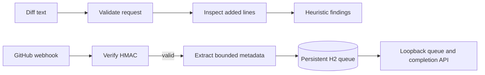

# ReviewPilot

## Purpose and learning goals

ReviewPilot explores safer pull-request review automation: inspect only changed lines, produce actionable findings, and keep a human responsible for review decisions. It teaches webhook verification and why untrusted repository code must never be executed.

**Current implementation:** local static diff scanning for added TODO/FIXME markers and likely hard-coded secrets. Unified-diff hunk positions map findings to file paths and new-file line numbers. The optional webhook endpoint verifies an HMAC, extracts only repository/pull-request/action metadata, and stores a persistent H2 queue entry keyed by the delivery ID. Raw webhook payloads are discarded; no GitHub API calls or comments are made.

## How it works



## Run and try it

Requires Java 21 and Maven. Run `mvn spring-boot:run`; the app binds to `127.0.0.1:8085`.

```powershell
$body = @{ diff = "@@ -1,0 +1,2 @@`n+TODO: finish validation`n+api_key=abcdefghijklmnop" } | ConvertTo-Json
Invoke-RestMethod -Method Post -Uri http://127.0.0.1:8085/api/reviews `
  -ContentType 'application/json' -Body $body
```

Expected: `source` is `LOCAL_STATIC_SCAN`; findings include the changed file, new-file line number, submitted diff-line number and heuristic severity. Removed lines are ignored. No external repository is contacted.

To exercise `POST /api/webhook/github`, set `GITHUB_WEBHOOK_SECRET` in the process environment and send a GitHub-shaped raw JSON body with `X-GitHub-Event: pull_request`, a unique `X-GitHub-Delivery` ID, and a valid `X-Hub-Signature-256`. The body must contain `action`, `repository.full_name`, and `pull_request.number`. Without a configured secret it returns HTTP 503; invalid signatures and duplicate delivery IDs are rejected. The queue and replay IDs persist in `data/reviewpilot/reviews.mv.db`; override the database URL/credentials with `REVIEWPILOT_DB_URL`, `REVIEWPILOT_DB_USERNAME` and `REVIEWPILOT_DB_PASSWORD`.

Inspect the bounded pending queue with `GET /api/webhook/queue?limit=50` and mark an item complete with `POST /api/webhook/queue/{deliveryId}/complete`. Up to 1,000 items may be pending; delivery IDs remain recorded after completion so GitHub retries cannot enqueue them again. The listener binds to loopback by default.

## Tests and exercises

Run `mvn test`. Tests check added-line scanning, likely credentials, HMAC validation, persisted metadata queue behavior, durable replay rejection, bounded paging and the explicit no-GitHub-write notice.

1. Add a TODO only on a removed line and confirm it is ignored.
2. Try a secret-like string shorter than the detector threshold and document the false-negative risk.
3. Fill the local replay cache in a controlled test and decide how a production queue should expire IDs safely.

## Limitations and next work

There is no GitHub App, installation authentication, automated diff fetch, AI reviewer, duplicate aggregation, reaction capture, or comment posting. The local metadata queue is durable but not yet connected to a review worker. Findings are heuristics and must not be treated as approval decisions.

**Screenshot placeholder:** add a capture of a sample local diff review after a review UI is implemented.

References: [ThrillhouseBot](https://github.com/devops-thiago/ThrillhouseBot), [GitHub webhook validation](https://docs.github.com/en/webhooks/using-webhooks/validating-webhook-deliveries).
