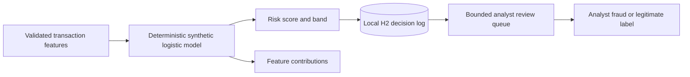

# FraudGuard

## Purpose and learning goals

FraudGuard demonstrates a classical model for ranking transaction risk and exposing feature contributions for human review. It teaches that numeric scoring and validation should drive decisions, while a language model may only explain verified evidence.

**Current implementation:** a deterministic logistic-regression model trains on 200,000 generated transactions over 60 days. The first 48 days train the model; the final 12 days form a chronological holdout. Its bias starts at training-set prevalence and full-batch training makes the synthetic high-risk pattern enter the review band. Responses include holdout average precision, 10-bin expected calibration error, and per-feature population stability index (PSI) comparing normalized training and holdout features. PSI uses ten fixed bins on [0, 1], additive smoothing, and a 0.2 alert threshold. Each score also returns request latency; `GET /api/score/metrics` summarizes the latest 512 durations with average, p50, p95 and max. The synthetic fixture intentionally has no distribution shift, so this is a drift-monitor implementation check, not evidence of real production drift detection. It uses no personal or real transaction data.

## How it works



## Run and try it

Requires Java 21 and Maven. Run `mvn spring-boot:run`; the service binds to `127.0.0.1:8086`.

```powershell
Invoke-RestMethod -Method Post -Uri http://127.0.0.1:8086/api/score `
  -ContentType 'application/json' `
  -Body '{"amount":420,"recentTransactions":7,"accountAgeDays":12,"countryMismatch":true}'
```

Expected: the response includes a persisted `decisionId`, a `riskScore` from 0 to 100, a `LOW`/`REVIEW`/`HIGH` band, logit feature contributions, and an `evaluation` object with generated/training/holdout counts, generated positive rate, holdout average precision, calibration error, and `featureDrift` (`features`, maximum PSI, threshold and drift flag). It is an educational output only. Review decisions with `GET http://127.0.0.1:8086/api/reviews?limit=50`; submit `PUT /api/reviews/{decisionId}/label` with `{"label":"FRAUD"}` or `{"label":"LEGITIMATE"}`.

Each score response also includes `scoringLatencyMicros`. Inspect bounded recent aggregates with `Invoke-RestMethod http://127.0.0.1:8086/api/score/metrics`.

## Tests and exercises

Run `mvn test`. Tests check deterministic model output, shifted-feature detection and invalid drift samples, latency response and rolling-window percentiles, and the H2-persisted review queue and one-time analyst labels.

1. Submit the same amount with `countryMismatch` set to `false`, then compare feature contributions.
2. Change account age or transaction velocity and observe the score; explain why a contribution is not causal evidence.
3. Add precision, recall and PR-AUC by threshold; explain why the 60-day synthetic holdout cannot establish real-world performance.

## Limitations and next work

The generated distribution, labels and metrics are not evidence of real fraud-detection quality. Drift is measured only across the generated chronological training and holdout fixtures; there is no live baseline registry, streaming drift monitor, persistence, or alert delivery. Latency aggregates are process-local and reset when the app restarts. The local H2 review workflow has no operator authentication, Redis velocity features, model registry, or promotion rules. Calibration error is an evaluation metric, not a calibration correction. Do not use this model for financial decisions.

**Screenshot placeholder:** add a capture of a synthetic scoring response and contribution chart if an analyst console is built.

References: [Oracle Tribuo](https://github.com/oracle/tribuo), [DJL Serving](https://github.com/deepjavalibrary/djl-serving).
