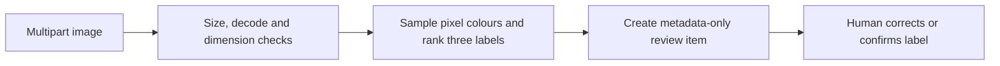

# VisionCheck

## Purpose and learning goals

VisionCheck is an image-intake learning slice for inspecting local photos. It demonstrates upload bounds, image decoding, dimension checks and the difference between a hand-built heuristic and a trained classifier.

**Current implementation:** a top-three colour-score heuristic and a same-origin browser review client. PNG/JPEG MIME and actual file format must match; ImageIO checks image dimensions and pixel count before decoding, ignores metadata, then processes pixels in memory. Each prediction enters a bounded in-memory review queue with dimensions and labels only; image bytes and EXIF are not retained. The browser shows a local object-URL preview, candidate scores, and the pending metadata queue; reviewers can confirm or correct the label.

## How it works



## Run and try it

Requires Java 21 and Maven. Run `mvn spring-boot:run`; open `http://127.0.0.1:8087/` for the browser client. The API and static client bind to `127.0.0.1:8087`.

```powershell
curl.exe -F "image=@sample.png;type=image/png" http://127.0.0.1:8087/api/classify
```

Expected: top-three heuristic candidates, image dimensions, a review ID and `REVIEW_REQUIRED`. The endpoint accepts only PNG/JPEG with matching content type, rejects images over 5 MB, over 4000 pixels in either dimension, or over 12 megapixels before decoding. The browser client previews the selected image in the tab, explains the heuristic candidates, lists pending records from `GET /api/classification-reviews`, and confirms or corrects a label with `PUT /api/classification-reviews/{id}`. Only generated review metadata and the human label are retained by the server; image bytes and embedded metadata are discarded.

## Tests and exercises

Run `mvn test`. Tests check invalid image and MIME mismatch rejection, pre-decode dimension bounds, top-three predictions, review queue creation, metadata-only correction, and duplicate-review rejection.

1. Compare red-, green- and blue-dominant fixture images and inspect the baseline labels.
2. Add tests for the file-size and dimension limits.
3. When a licensed dataset and model are available, compare a DJL classifier against this baseline and report per-class precision and recall.

## Limitations and next work

The app does not use DJL, train a model, or call an optional vision-language model. It ignores embedded metadata during decoding and stores no image, but has no reusable EXIF-stripping pipeline for a future storage feature. The review queue is process-local, capped at 1,000 records, and resets on restart. Candidate scores are heuristic signals, not calibrated probabilities. The next book steps are a predictor pool, model-versioned predictions, EXIF-safe storage and test-set metrics.

**Screenshot placeholder:** add a browser capture after the model-backed classifier replaces the current colour heuristic.

References: [DJL](https://github.com/deepjavalibrary/djl), [DJL Spring Boot demo](https://github.com/deepjavalibrary/djl-spring-boot-starter-demo).
