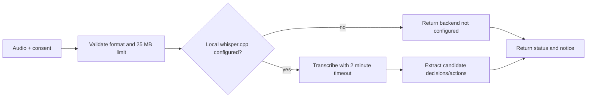

# VoiceNotes

VoiceNotes accepts a consent-confirmed audio upload, optionally transcribes it with a local whisper.cpp executable, builds a short extractive summary, and extracts candidate decision/action sentences. It keeps the uploaded recording in a temporary directory and deletes that directory after transcription.

## Learning goals and current scope

- Require explicit consent and validate media type and size.
- Invoke a local process with an argument list, timeout, bounded output, and cleanup.
- Treat the extractive summary and candidate decisions/actions as suggestions that need human verification.
- Accept background jobs with a bounded worker and queue so a caller can poll a job state.

The API binds to `127.0.0.1:8089`. Transcription is injected through the `AudioTranscriptionProvider` interface; the only implementation is local whisper.cpp. Without a configured local model it returns `BACKEND_NOT_CONFIGURED` and an empty transcript rather than sending audio to a cloud provider. Set `FFMPEG_BINARY` to opt into local normalization and segmentation. ffmpeg converts audio to ordered mono 16 kHz WAV chunks of five minutes; a 60-minute conversion cap, 12-segment limit, three-minute normalization timeout, two-minute per-segment transcription timeout, and temporary-file cleanup bound the workflow. Without `FFMPEG_BINARY`, Whisper processes the uploaded file directly as before.

## Flow



## Run and try it

Requires Java 21 and Maven. From this directory run `mvn spring-boot:run`. To enable transcription, set `WHISPER_CPP_BINARY` and `WHISPER_CPP_MODEL` to local paths before starting the app. Set `FFMPEG_BINARY` to the local ffmpeg executable to enable normalization and segmentation. Use a recording you have permission to process.

```powershell
curl.exe -X POST http://127.0.0.1:8089/api/transcripts `
  -F "consent=true" -F "audio=@meeting.wav;type=audio/wav"
```

The response contains a generated transcript ID, transcript, status, a summary made from the first three transcript sentences, candidate decisions/actions, analysis method, and a verification notice. In the unconfigured case the status is `BACKEND_NOT_CONFIGURED` and the summary is empty. The summary and action extraction do not invent or paraphrase transcript content.

For asynchronous processing, send the same multipart fields to `POST /api/transcript-jobs`. It returns HTTP 202 with a job ID and status URL. Poll `GET /api/transcript-jobs/{id}` for `QUEUED`, `PROCESSING`, `COMPLETED`, or `FAILED`; completed job results include transcript analysis. The process-local worker queue has two workers and four waiting slots. Job metadata and completed transcript results persist in `data/voicenotes/transcripts.mv.db`; override the file database with `VOICENOTES_DB_URL`, `VOICENOTES_DB_USERNAME` and `VOICENOTES_DB_PASSWORD`. History is capped at 100 jobs, and old jobs can be deleted below. Audio bytes remain only in process memory while queued and are discarded afterward. If the app restarts mid-job, the job is recovered as `FAILED` with a safe retry message.

Search completed job transcripts with `GET /api/transcripts/search?q=budget&limit=10`; results include a short matching excerpt and summary. Remove a retained transcript result with `DELETE /api/transcripts/jobs/{id}`. Search reads the persistent local job history. Delete does not cancel audio already held by a running worker.

## Tests and exercises

Run `mvn test`. Tests check that consent is required before transcription, extractive summary/action parsing returns only source sentences, and a background job advances to completion.

1. Submit `consent=false` and verify no transcription begins.
2. Try a supported media type and an unsupported type; inspect the bounded validation behavior.
3. Add a fake transcriber test for timeout and cleanup; then add timestamped segments without persisting audio.

## Limitations and next steps

Audio job execution remains process-local and queued bytes are lost on restart; persisted queued/processing jobs are marked failed on startup for safe resubmission. It does not store audio durably. Search is substring-based, and deletion cannot interrupt a running worker. There is no ffmpeg normalization, long-recording segmentation, timestamped transcript, speaker diarization, LLM map-reduce summary, text-to-speech, access control, configurable retention policy, or browser UI. The summary is extractive, not a summary model. Never treat a detected action as an assignment without review.

**Screenshot placeholder:** add the consent/upload/status UI after it is implemented.

References: [whisper.cpp](https://github.com/ggml-org/whisper.cpp), [Spring file upload guide](https://spring.io/guides/gs/uploading-files).
