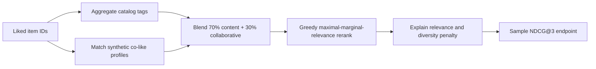

# ShelfWise

ShelfWise ranks a small fictional book catalog using local Ollama text embeddings when available, with tag cosine and synthetic co-like behavior as a deterministic fallback. Each result exposes its content method and score components so the recommendation can be inspected instead of presented as an unexplained prediction.

## Learning goals and current scope

- Combine content similarity with a collaborative signal.
- Explain ranking components and evaluate a sample ranking with NDCG.
- Separate synthetic offline metrics from evidence about real customers.

The catalog and sample profiles are in memory. The service binds to `127.0.0.1:8090` and returns up to three unseen books. For local semantic vectors, install Ollama and run `ollama pull nomic-embed-text`; configure `OLLAMA_BASE_URL` and `OLLAMA_EMBEDDING_MODEL` if needed. `SHELFWISE_OLLAMA_CACHE_MAX_ENTRIES` bounds a process-local LRU cache (default 1,000 vectors; set to `0` to disable it). Cache entries are tied to this client's configured model and disappear when the app restarts. If the embedding request times out or the model is unavailable, the request uses the visible tag-cosine fallback.

## Flow



## Run and try it

Requires Java 21 and Maven. From this directory run `mvn spring-boot:run`.

```powershell
Invoke-RestMethod -Method Post -Uri http://127.0.0.1:8090/api/recommendations `
  -ContentType 'application/json' -Body '{"likedItemIds":["BK1"]}'
Invoke-RestMethod http://127.0.0.1:8090/api/recommendations/evaluation
```

The request may provide `interactions` alongside `likedItemIds`, for example `[{"itemId":"BK1","type":"PURCHASE","occurredAt":"2026-10-01T10:00:00Z"}]`. `VIEW`, `LIKE`, and `PURCHASE` use base weights 0.25, 1.0, and 1.5, with a 30-day half-life; timestamps in the future are ignored. Up to 500 events are accepted. Event weights shape both the semantic/tag profile and synthetic co-like affinity. These events are request-scoped and are not persisted or associated with an authenticated user.

The recommendation response includes item ID/title, content method, relevance score, content similarity, co-like signal, base relevance, diversity penalty, and a short explanation. A greedy maximal marginal relevance (MMR) reranker subtracts up to `0.2 ×` maximum embedding cosine similarity (or tag cosine fallback) to already selected items. The evaluation route returns a fixed synthetic ranking and `NDCG@3` with a warning that it is not a real-user metric.

## Tests and exercises

Run `mvn test`. Tests check that liked items are excluded, recent events influence the profile more than old events, the sample metric is bounded, repeated embedding requests use the local cache, least-recently-used entries are evicted, and disabling the cache or setting it below batch size still returns vectors.

1. Like `BK2` and compare the content and co-like contributions.
2. Add a filter for unavailable items and verify it runs before ranking.
3. Add a time-decayed interaction profile and test NDCG@10 and catalogue coverage on a larger held-out set.

## Limitations and next steps

This is not a production personalized service: events are supplied on each request, with no authenticated users or durable profiles; catalogue embeddings are not persisted in pgvector, and there are no popularity signals or feedback loop. Embedding cache data is local to one process and is not durable; the synthetic profiles are tiny. The book's fuller design adds persistent catalogue vectors, candidate generation, and recall@10/NDCG@10/coverage/diversity evaluation.

**Screenshot placeholder:** add an interactive ranked-list and score-breakdown capture when a UI is implemented.

References: [Spring AI vector stores](https://docs.spring.io/spring-ai/reference/api/vectordbs.html), [MovieLens datasets](https://grouplens.org/datasets/movielens/).
