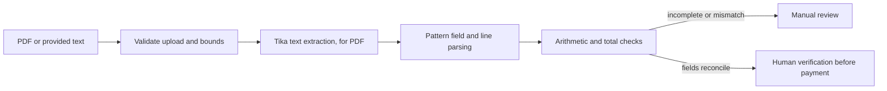

# PaperTrail

PaperTrail extracts a small, explicit invoice text format into structured invoice/party/tax fields and checks arithmetic before returning a review status. It also accepts a PDF and uses Tika to read embedded text locally.

## Learning goals and current scope

- Bound file size/type and reject content that is not a PDF.
- Extract supplier/buyer, invoice number/date, currency, GSTIN, tax, total, and line items when present.
- Reconcile quantity × unit price and line sum plus tax against invoice total.
- Route incomplete or inconsistent results to manual review.

The host service binds to `127.0.0.1:8091`. It does not store uploads or approve payments. A container image installs Tesseract OCR and binds inside the container; use it for image-only scanned PDFs.

## Flow



## Run and try it

Requires Java 21 and Maven. From this directory run `mvn spring-boot:run`. For a quick text test:

```powershell
$invoice = @'
Invoice Number: INV-204
Supplier: Northstar Supplies
Buyer: Aaron S
Date: 2026-10-17
Currency: INR
GSTIN: 27AABCU9603R1ZN
Paper | 2 | 3.50 | 7.00
Tax: 0.56
Total: 7.56
'@
Invoke-RestMethod -Method Post -Uri http://127.0.0.1:8091/api/invoices/extract-text `
  -ContentType 'application/json' -Body (@{ text = $invoice } | ConvertTo-Json)
```

For PDF upload use `curl.exe -F "file=@invoice.pdf;type=application/pdf" http://127.0.0.1:8091/api/invoices/extract-file`. The checked-in synthetic regression invoice is `src/test/resources/fixtures/invoice-extraction-fixture.pdf`; upload it with:

```powershell
curl.exe -F "file=@src/test/resources/fixtures/invoice-extraction-fixture.pdf;type=application/pdf" `
  http://127.0.0.1:8091/api/invoices/extract-file
```

It should return invoice `INV-PT-2026-001`, supplier `Northstar Supplies`, one `Widget` line, INR 20.00 subtotal, INR 1.60 tax, INR 21.60 total, and `EXTRACTED_REVIEW_BEFORE_PAYMENT`. The Spring integration test uploads this fixture through the multipart endpoint and verifies extracted fields and reconciliation. The response includes extracted fields, line items, per-field evidence labels, a `LOW` or `MEDIUM` overall label, and a review/extracted status. If tax is present, line-items total plus tax must match invoice total. Even a reconciled result says to verify the original. A GSTIN is included only when its structure and base-36 check character match; this offline check does not confirm registration status, legal identity, or OCR accuracy.

Start EvalOps alongside PaperTrail and call `GET http://127.0.0.1:8092/api/evaluations/golden/papertrail` to run the same fixture through the local HTTP API and check its extracted fields and arithmetic.

To run the OCR-enabled image locally, build from the portfolio root with `docker build -t papertrail-ocr:local projects/11-papertrail`, then run `docker run --rm -p 127.0.0.1:8091:8091 papertrail-ocr:local`. The image installs the English Tesseract engine. OCR is fallible: a generated image-only invoice smoke check extracted the main invoice fields and arithmetic, but misread a GSTIN character and correctly routed the invoice to manual review. Confidence labels indicate pattern matches, not calibrated OCR certainty.

Run the repeatable image build, health check, scanned-PDF upload and safety assertions from the portfolio root with `pwsh -File projects/11-papertrail/scripts/test-ocr-container.ps1`. It builds the image, publishes the app only on loopback using an ephemeral host port, uploads the checked-in scan, verifies key fields/arithmetic and the human-verification notice, then stops its temporary container. The image is retained locally for reuse.

## Tests and exercises

Run `mvn test`. Unit tests check line arithmetic and manual review; the multipart integration test exercises local Tika extraction from the checked-in PDF and validates the result fields and totals.

1. Change the total from `7.00` to `8.00` and confirm the result becomes `MANUAL_REVIEW_REQUIRED`.
2. Remove the ISO date or change the line amount and inspect the review reason.
3. Extend the GSTIN parser with a source-of-truth registration lookup, while keeping its offline checksum test independent and routing mismatches to manual review.

## Limitations and next steps

The parser handles a narrow line format. Scanned pages require the OCR-enabled container image; OCR may misread characters. It has no calibrated confidence, live GSTIN registry validation, correction UI, encrypted storage, or benchmark set. A checksum only catches some transcription errors; it does not prove a GSTIN exists. No extraction result may initiate a payment.

Checksum implementation follows the base-36 check-character procedure in the [GSTN sample validator](https://gist.github.com/karthikeyan5/f7b28e66ac9617603622491950bda77a).

**Screenshot placeholder:** add a side-by-side original invoice and review form after the UI is implemented.

References: [Apache Tika](https://tika.apache.org/), [Spring AI Tika reader](https://docs.spring.io/spring-ai/reference/api/etl-pipeline.html).
