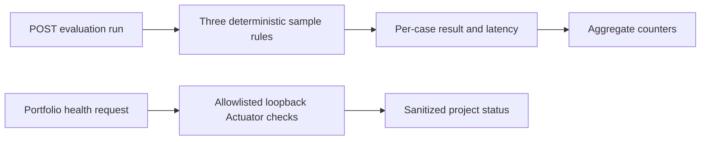

# EvalOps

EvalOps is the portfolio's local evaluation and health dashboard API. Its current evaluation endpoint runs deterministic example checks, measures elapsed time, and keeps aggregate counters. Its golden runners verify AskYourData, DocuMind, PaperTrail, and VisionCheck using fixed loopback-only adapters and versioned fixtures. Its health endpoint checks only the allowlisted loopback ports of the twelve portfolio apps and returns sanitized `UP`/`DOWN` states.

## Learning goals and current scope

- Turn safety and grounding expectations into repeatable checks.
- Report evaluation outcomes and aggregate latency without retaining user prompts.
- Observe portfolio service availability without returning internal health details.

The app binds to `127.0.0.1:8092`. Evaluation samples are synthetic; health checks are independent of model quality.

## Flow



## Run and try it

Requires Java 21 and Maven. From this directory run `mvn spring-boot:run`.

```powershell
Invoke-RestMethod -Method Post http://127.0.0.1:8092/api/evaluations/run
Invoke-RestMethod http://127.0.0.1:8092/api/evaluations/metrics
Invoke-RestMethod http://127.0.0.1:8092/api/evaluations/golden/askyourdata
Invoke-RestMethod http://127.0.0.1:8092/api/evaluations/golden/papertrail
Invoke-RestMethod http://127.0.0.1:8092/api/evaluations/golden/visioncheck
Invoke-RestMethod http://127.0.0.1:8092/api/portfolio/health
```

The evaluation response has three synthetic case results, passed/total counts, elapsed microseconds, and a privacy notice. Metrics return run count, fully passing run count, and average latency. EvalOps also records `evalops.evaluation.runs` (tagged only with pass/fail outcome), `evalops.evaluation.duration`, a `evalops.evaluation.run` observation, and Spring's HTTP server metrics/traces. `/actuator/metrics` is exposed on the loopback-bound server. Health returns all twelve configured names and `UP`/`DOWN`; projects need to be running for `UP`.

OTLP export is disabled unless explicitly enabled. To send metrics and traces to an OpenTelemetry Collector listening on the local OTLP/HTTP port, set:

```powershell
$env:EVALOPS_OTLP_METRICS_ENABLED = 'true'
$env:EVALOPS_OTLP_TRACING_ENABLED = 'true'
$env:EVALOPS_OTLP_METRICS_URL = 'http://127.0.0.1:4318/v1/metrics'
$env:EVALOPS_OTLP_TRACING_ENDPOINT = 'http://127.0.0.1:4318/v1/traces'
mvn spring-boot:run
```

Use the collector's Prometheus exporter and a Prometheus/Grafana backend for dashboards; EvalOps does not retain prompts or export golden-case text. Endpoint URLs and optional authentication headers can be configured with Spring Boot's `management.otlp.*` properties. Keep credentials in environment variables or a secrets manager. See the official [Spring Boot OTLP metrics](https://docs.spring.io/spring-boot/3.5/reference/actuator/metrics.html) and [tracing](https://docs.spring.io/spring-boot/3.5/reference/actuator/tracing.html) documentation.

Both golden-runner responses include `passRate`, `minimumPassRate`, and `qualityGatePassed`. AskYourData defaults to an 80% minimum and DocuMind to 67%; override them with `EVALOPS_ASKYOURDATA_MINIMUM_PASS_RATE` or `EVALOPS_DOCUMIND_MINIMUM_PASS_RATE` (values from 0 to 1). A run with no loaded cases always fails the gate. Consumers can make the result a build gate, for example:

```powershell
$report = Invoke-RestMethod http://127.0.0.1:8092/api/evaluations/golden/askyourdata
if (-not $report.qualityGatePassed) { throw "AskYourData golden gate failed: $($report.passed)/$($report.total)" }
```

Golden cases run on a shared fixed-size executor (four workers by default) with a bounded queue of 64 pending cases so the AskYourData benchmark fits without overload; the queue remains fixed and bounded. Set `EVALOPS_PARALLELISM` from 1–8 and `EVALOPS_QUEUE_CAPACITY` from 1–128. Saturated submissions become failed case results (`EVALUATION_CAPACITY_REACHED`), preserve input order in the report, and count against the quality gate.

The golden endpoint loads `src/main/resources/golden/askyourdata.jsonl` and sends each case to the fixed loopback `/api/analytics` adapter. In addition to the fixed SQL/report/result checks, each case validates the structured query plan's semantic source table, dimensions, metric source columns/aggregation, empty filter list, and row limit. The default origin is `127.0.0.1:8088`; `EVALOPS_ASKYOURDATA_BASE_URL` may select another HTTP loopback origin, while remote hosts and path-bearing URLs are rejected. Start AskYourData to see passing cases. If it is unavailable, cases return `APP_UNAVAILABLE_OR_INVALID_RESPONSE`; requests have a three-second timeout.

For DocuMind, create a collection, upload `src/main/resources/golden/documind-evaluation.md`, and pass that collection's UUID to `GET /api/evaluations/golden/documind?collectionId=<uuid>`. This loopback-only adapter measures per-case evidence-term recall from returned source snippets and whether answer citations exist and resolve to returned source IDs. The base origin defaults to `http://127.0.0.1:8081`; set `EVALOPS_DOCUMIND_BASE_URL` to another local loopback port if needed. Non-loopback URLs are rejected. The report contains aggregate passes and numeric recall without retaining full answers or source text. Run DocuMind with PostgreSQL/pgvector and Ollama; missing collections, model errors and unavailable apps fail the affected case with sanitized detail.

For PaperTrail, start the local service and call `GET /api/evaluations/golden/papertrail`. EvalOps uploads the bundled synthetic invoice PDF through the multipart endpoint, checks invoice/party/identity/line-item fields, tax arithmetic and review status, and returns gate details without retaining the extraction response. The expected case is in `src/main/resources/golden/papertrail.jsonl`; its PDF is loaded from PaperTrail's fixture directory at build time. Configure `EVALOPS_PAPERTRAIL_BASE_URL` only with an HTTP loopback origin; the default quality gate requires the single golden case to pass.

For VisionCheck, start the local service and call `GET /api/evaluations/golden/visioncheck`. EvalOps uploads the bundled 24×16 synthetic blue PNG to the fixed loopback API, checks the predicted top label, candidate count/score bounds, dimensions and `REVIEW_REQUIRED` state, confirms the metadata-only review appears in the pending queue, records the case's human-confirmed label, and verifies the item leaves the pending list. The report does not retain image bytes or the application response. Configure `EVALOPS_VISIONCHECK_BASE_URL` only with an HTTP loopback origin; the default quality gate requires its case to pass.

## Tests and exercises

Run `mvn test`. Unit tests check deterministic case results, aggregate counters, all twelve health entries, and output sanitization. These tests do not require the other apps to be running.

1. Run EvalOps twice and check that aggregate counters increase.
2. Start one other app and compare `/api/portfolio/health`; verify it reports only a sanitized status.
3. Extend the DocuMind fixture with known evidence terms and compare recall values before changing retrieval settings.

## Limitations and next steps

The golden runners cover 50 AskYourData question phrasings across three fixed reports, three DocuMind retrieval/citation cases, one PaperTrail invoice fixture, and one VisionCheck image/review fixture, with semantic-plan/data checks, evidence-term recall, structured invoice-field/arithmetic checks, and human-review workflow checks respectively. AskYourData's 50 cases exercise only the constrained report mapper, not broad model-based text-to-SQL accuracy. OTLP metrics and traces are supported when enabled, but the suite has no LLM judge/cache, JUnit extension, token usage, provisioned Grafana dashboard, or scheduled CI report. The image, DocuMind and PaperTrail fixtures are synthetic and must not be mistaken for broad quality evidence. The loopback health/evaluation endpoints remain fixed allowlisted probes rather than arbitrary URL fetchers.

**Screenshot placeholder:** add an evaluation report and service-health table when a dashboard is implemented.

References: [OpenTelemetry Java](https://opentelemetry.io/docs/languages/java/), [Spring Boot Actuator](https://docs.spring.io/spring-boot/reference/actuator/index.html).
